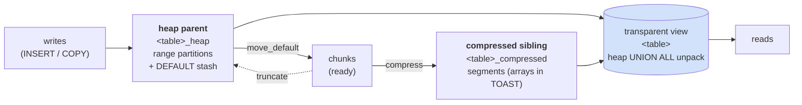

# PgSeries (fork) — "TimescaleDB lite" in pure SQL

> **Fork of [NikolayS/pgseries](https://github.com/NikolayS/pgseries)**
> (`upstream`). This branch (`feat/pgseries-transparent`) continues
> development here: transparent reads, set-based packing, estimate
> tooling. Canonical design doc: [SPEC.md](./SPEC.md).

Hypertables, continuous-aggregate-shaped rollups (roadmap), columnar
compression and retention — on **any Postgres 17+, no C, no
extensions, no restart**. Single-file install:

```bash
psql -v ON_ERROR_STOP=1 -f pgseries.sql   # one transaction
```

If you've used TimescaleDB you know the shape: `create_series_table`,
`show_chunks` / `drop_chunks`, `add_compression_policy`,
`add_retention_policy`. Same names, same mental model — implemented
in SQL + PL/pgSQL. Honest trade: **2–4× compression instead of
8–15×** (no bit-level codecs without C), BRIN + partition pruning
instead of planner hooks.

## How it works



1. **Series tables** are native range-partitioned tables on the time
   column, plus a `DEFAULT` partition. Rows for missing ranges land
   in `<table>_default`; `move_default()` (or the `move_default`
   job) creates the partitions and relocates them — one grouping
   scan, one final sweep. A `precreate_chunks()` job keeps N chunks
   ahead so the hot path is plain PG row-routing, zero PgSeries code.
2. **Chunk leases** (`pgseries.chunk_lease`) coordinate state:
   `pending → ready → compressing → compressed`
   (`compressed → compressing` for recompression,
   `ready/compressed → leased_for_drop` for retention). Every
   transition is a `FOR UPDATE SKIP LOCKED` claim in the same
   transaction as the DDL it guards.
3. **Compression** packs each cold chunk's heap rows into **segments**
   in the `<table>_compressed` sibling tree (one partition per
   chunk). The heap is truncated and kept empty as **staging** for
   late writes. `decompress_chunk()` reverses it (`compressed →
   ready`).
4. **Reads are transparent**: at policy time the heap parent is
   renamed to `<table>_heap` and the base name becomes a `UNION ALL`
   view (heap + lateral unpack). `SELECT * FROM t` sees everything.
   Bulk ingest (`COPY`) and movers address `<table>_heap` directly —
   view row-triggers cost ~11×/row (measured), so the hot path never
   goes through them. `TRUNCATE`/DDL likewise target the heap (PG
   forbids them on views).
5. **Jobs**: `add_retention_policy`, `alter/pause/resume_job`,
   `run_job_now` (synchronous runner; PgQue ticker in v0.2 full).

## Segments: what a compressed row holds

One segment ≈ `segment_rows` source rows (default 1000), grouped by
`segmentby`, sorted by `orderby`. Columns follow `c<attnum>_<role>`:

```
seg_no | <segby…> | seg_min_ts | seg_max_ts | seg_row_count | c1_base | c1_arr | c1_nulls | …
   6   |    d5    |  158 rows  |  17:12:16  |    …          | 1783023…| {86400…}|    {}    | …
```

| Codec | Stores | Best for |
|---|---|---|
| `delta` | first value + diffs | monotonic ts / counters |
| `for` | min + offsets | hash-noise ints |
| `auto` | measured at policy time, stored resolved | ints when unsure |
| `dict` | `text[]` dict + `int[]` indices | low-cardinality text |
| `raw` | plain array | floats (bit-exact), numeric, jsonb |

`segmentby` columns are scalars (predicates skip whole segments
without unnesting). NULLs are `int[]` positions (sparse-friendly).
Arrays are `storage extended + compression lz4` → TOAST does the
squeezing. Side stats + `BRIN minmax_multi_ops` on
`(seg_min_ts, seg_max_ts)` (plus BRIN per segmentby) give data
skipping without planner hooks; `_read_range(a, b)` pushes seg bounds
before the `LATERAL` unnest fires.

Two automatic guards (with `NOTICE`, stored resolved):

- **dict → raw** when sample distinct count exceeds `segment_rows`
  (a uuid dict measured 340 KB/segment for zero gain, plus O(n·d)
  pack cost).
- **min rows** (`p_min_rows`, default one segment): tiny chunks stay
  `ready` — a 500-row chunk measured 64 kB → 136 kB compressed.

## For which columns

- **Timestamps / monotonic ints** → `delta`. Best ratio (runs → ~1 B/value).
- **Hash-noise ints** → `for`.
- **Low-cardinality text/bool** (`region`, `status`, `device`) → `dict`
  — and the best `segmentby` candidates (≤ ~10⁴ distinct/chunk).
- **Floats** → `raw` (exact), opt-in lossy `requant` (`'{"temp": 3}'`
  measured ~14× on noisy gauges — 3 significant digits).
- **numeric / jsonb / bytea** → `raw`. Repetitive jsonb compresses
  poorly — normalize to plain columns first (measured: 28 MB of
  `meta` jsonb → ~1 MB as two columns).
- **uuid / free text / hashes** → `raw` by guard; essentially
  incompressible (entropy). Schema design beats codecs here.

## Compress

```sql
-- policy once (codecs '{}' = auto-measured; segmentby = lookup key)
SELECT pgseries.add_compression_policy('public','m1','{device}','ts');

-- everything cold, one statement (default skips hot + tiny chunks)
SELECT pgseries.compress_table('public','m1');

-- or a single chunk (p_min_rows override for small ones)
SELECT pgseries.compress_chunk('public','m1','m1_p20261004000000');

-- what did I get?
SELECT * FROM pgseries.compressed_chunk_stats('public','m1') LIMIT 5;
SELECT pgseries.suggest_compression('public','m1');  -- tries codecs/sizes
SELECT * FROM pgseries.bench_codecs('public','m1','{device}',200000);
```

`compress_table(schema, table [, older_than [, include_hot [, min_rows]]])`.
`add_retention_policy` refuses chunks overlapping cagg refresh windows
(from v0.3 on).

## Decompress

```sql
-- one chunk back to heap (lease -> ready), data intact
SELECT pgseries.decompress_chunk('public','m1','m1_p20261004000000');

-- drop the whole policy (requires zero compressed chunks):
-- transparent view is removed, plain partitioned table restored
SELECT pgseries.drop_compression_policy('public','m1');
```

Late writes to compressed ranges land in the chunk's heap staging
(`staging` mode, default) and merge on the next compress; reads see
them immediately through the view.

## Measured (local NVMe, PG 18)

| Shape | Rows | Heap | Compressed | Ratio |
|---|---|---|---|---|
| IoT narrow (`ts, device, temp, cnt`) | 1 000 000 | 66 MB | 23 MB | 2.9× |
| Business (`pedidos`, 11 cols + jsonb) | 500 000 | 93 MB | 28 MB | 3.3× |
| Web text-heavy (uuid + urls) | 500 000 | 44 MB | 29 MB | 1.5× |

Routine costs: 1M-row pack ~2 s (one statement), 290K-row range
scan ~1 s, `bench_codecs` ~8 s, `suggest_compression` ~5 s on 500K.
`COPY` via view triggers ≈ 11× slower than heap-direct — bulk loads
target `<table>_heap`.

## Limits (honest)

- No btree on cold data: point lookups on compressed ranges unnest
  pruned segments (ms, not sub-ms). Put the lookup key in
  `segmentby`; keep the hot window uncompressed for btree seeks.
- Floats lossless ≈ 1.5–2.5×; uuid/free-text ≈ 1×. Ratio is a
  function of entropy mix, not row count.
- PG 17+ only. Roles: `pgseries_reader` / `writer` / `admin`.
- Direct-to-leaf writes bypass nothing (fine pre-cagg); `ON CONFLICT`
  needs the partition key.

## Develop / test

```bash
./test/run.sh   # ephemeral PG, installs pgseries.sql, runs test/smoke.sql
```

`test/smoke.sql` is plain `DO` blocks (no extensions): partitioning,
mover, leases, retention, transparency + view DML, pack/stats
roundtrips for every codec, policy teardown. Green required before
push.

## Project docs

- [SPEC.md](./SPEC.md) — canonical project specification.
- [HTML brief](https://nikolays.github.io/pgseries/) — short readable overview.
